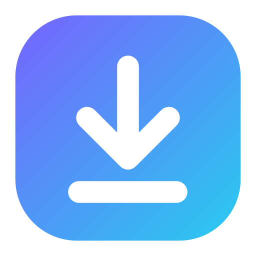

<p align="center">
  
</p>

<h1 align="center">Zubel</h1>

<p align="center">Interfaz gráfica moderna para <a href="https://github.com/yt-dlp/yt-dlp">yt-dlp</a>: descarga video y audio de YouTube y de más de 1800 sitios en MP4, MP3 y muchos formatos más.</p>

---

## Características

- **Vista previa del video** dentro de la app (reproduce el stream real) con miniatura, título, canal, duración y vistas.
- **Recorte visual**: slider de rango con dos puntos, burbujas de tiempo, campos editables, botones «Inicio aquí» / «Fin aquí» desde la vista previa, reproducción en bucle del fragmento y opción de cortes precisos.
- **Video**: MP4, MKV, WEBM, MOV, AVI, FLV · resolución (solo muestra las disponibles, de 144p a 8K) · códec preferido (H.264, H.265, VP9, AV1) · preferencia de FPS.
- **Audio**: MP3, M4A, AAC, OPUS, FLAC, WAV, OGG, ALAC, Vorbis u original sin recodificar · calidad de 64 kbps a 320 kbps o VBR máxima.
- **Tabla de formatos** para elegir manualmente los streams exactos de video y audio.
- **Subtítulos** (normales y automáticos, idiomas, SRT/VTT/ASS/LRC, incrustados), **miniatura** y **metadatos** incrustados, capítulos, división por capítulos, descripción e info JSON.
- **SponsorBlock**: elimina o marca patrocinios, intros, outros, autopromoción, etc.
- **Playlists**: lista con casillas para elegir qué elementos bajar, orden inverso y carpeta por playlist.
- **Varias descargas a la vez** con cola, límite configurable, pausa/reanudación, reintento, cancelación, registro de yt-dlp por descarga y cola persistente entre sesiones.
- **Red**: cookies del navegador o archivo (contenido privado o con restricción de edad), proxy, límite de velocidad, fragmentos en paralelo, reintentos, IPv4, geo-bypass, User-Agent.
- **Interfaz**: tema oscuro, animaciones (transiciones, interruptores, indicador lateral, barras de progreso suaves, notificaciones), color de acento, detección de enlaces del portapapeles, notificaciones del sistema, búsqueda en YouTube escribiendo texto.
- **Componentes autocontenidos**: yt-dlp, FFmpeg y Deno se descargan en la carpeta del programa (`bin/`), **nunca se instalan globalmente**. yt-dlp se actualiza solo al iniciar.

## Instalación (usuarios)

Descarga `Zubel-x.y.z-setup.exe` desde [Releases](../../releases). El instalador:

1. Instala Zubel para tu usuario (no pide permisos de administrador).
2. Descarga las **últimas versiones** de yt-dlp, FFmpeg y Deno desde sus repositorios oficiales a `…\Zubel\bin`.

También hay una versión portable (`.zip`): al abrirla por primera vez descarga los componentes.

> Deno es el runtime de JavaScript que yt-dlp necesita para resolver los desafíos de YouTube.

## Desarrollo

Requisitos: Python 3.10+ (probado con 3.13).

```bash
python -m venv .venv
.venv\Scripts\activate          # Windows  (Linux/macOS: source .venv/bin/activate)
pip install -r requirements.txt
python run.py
```

En la primera ejecución aparece un asistente que descarga los componentes a `bin/` dentro del repositorio (ignorado por git).

### Compilar

```bash
pip install pyinstaller
python tools/build.py
```

Genera `dist/Zubel/` y, si tienes [Inno Setup 6](https://jrsoftware.org/isinfo.php), `installer/Output/Zubel-<versión>-setup.exe`.

Al subir un tag `v*` a GitHub, el workflow `.github/workflows/release.yml` compila el instalador y la versión portable y los publica en Releases:

```bash
git tag v1.0.0
git push origin v1.0.0
```

## Estructura

```
zubel/
├── app.py            # punto de entrada (--install-deps para el instalador)
├── paths.py          # rutas: bin/ dentro de la instalación, config en %APPDATA%
├── config.py         # ajustes y opciones de descarga (JSON)
├── deps.py           # descarga/actualización de yt-dlp, FFmpeg y Deno
├── ytdlp.py          # opciones → argumentos de yt-dlp, parseo de info y progreso
├── manager.py        # cola concurrente (un proceso yt-dlp por descarga)
├── workers.py        # análisis de URL y descargas de componentes en segundo plano
└── ui/
    ├── theme.py          # tema oscuro (QSS) y colores
    ├── widgets.py        # slider de rango, vista previa, interruptores, toasts, animaciones
    ├── download_page.py  # nueva descarga
    ├── queue_page.py     # cola de descargas
    ├── settings_page.py  # ajustes y componentes
    ├── setup_dialog.py   # asistente de componentes
    └── main_window.py
```

## Aviso legal

Zubel es solo una interfaz para yt-dlp. Descarga únicamente contenido sobre el que tengas derechos o permiso, y respeta los términos de servicio de cada sitio. yt-dlp (Unlicense), FFmpeg (GPL) y Deno (MIT) no se distribuyen con Zubel: se descargan desde sus fuentes oficiales.
